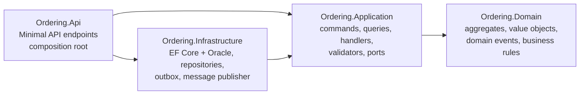
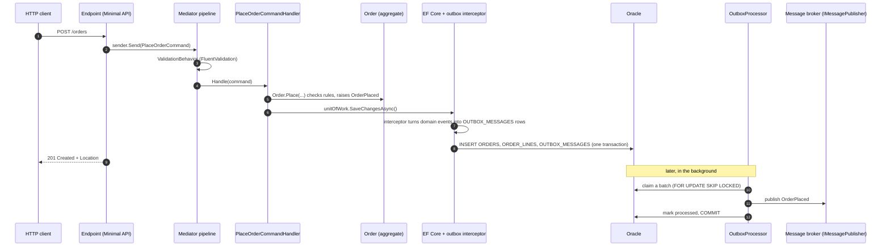

# Integration testing a Clean Architecture .NET API against a real Oracle database

[](https://github.com/RobinMechele/integration-test-example-c-sharp/actions/workflows/ci.yml)

A small but complete reference project that shows how to write **integration tests against a real database**
(Oracle, started in Docker by [Testcontainers](https://dotnet.testcontainers.org/)) for an ASP.NET Core
**Minimal API** built with **Clean Architecture**, the **mediator pattern** and the **transactional outbox pattern**.

Every practice used here is taken from a book, from official documentation or from a widely used open-source
project, and the [Sources](#10-sources-and-further-reading) section lists them. The README explains *what* is done
and also *why*, so you can apply the same ideas to your own codebase.

> **Short version:** business rules get fast unit tests. Everything that touches the database is tested against
> the same database engine as production (Oracle in a container), with the real EF Core migrations, a clean
> database before every test, and only the *unmanaged* dependencies (message broker, clock) replaced by test
> doubles. No in-memory database anywhere.

---

## Contents

1. [What's in the box](#1-whats-in-the-box)
2. [Quick start](#2-quick-start)
3. [Architecture](#3-architecture)
4. [Testing strategy](#4-testing-strategy)
5. [Oracle-specific notes](#5-oracle-specific-notes)
6. [Alternatives and trade-offs](#6-alternatives-and-trade-offs)
7. [Using PostgreSQL or SQL Server instead](#7-using-postgresql-or-sql-server-instead)
8. [Everyday commands](#8-everyday-commands)
9. [Repository layout](#9-repository-layout)
10. [Sources and further reading](#10-sources-and-further-reading)

---

## 1. What's in the box

| Concern | Choice | Version |
| --- | --- | --- |
| Runtime | .NET / C# | .NET 10 (LTS) |
| Entry point | ASP.NET Core Minimal API + OpenAPI + ProblemDetails | 10.0 |
| Mediator | [`Mediator`](https://github.com/martinothamar/Mediator) by Martin Othamar (MIT, source generated) | 3.0.2 |
| Validation | FluentValidation, run by a mediator pipeline behaviour | 12.2.0 |
| Persistence | EF Core + [`Oracle.EntityFrameworkCore`](https://www.nuget.org/packages/Oracle.EntityFrameworkCore) | 10.0 / 10.23.26400 |
| Database | Oracle Database Free 23 (image `gvenzl/oracle-free:23.26.3-slim-faststart`) | 23.26.3 |
| Messaging | Transactional outbox + polling publisher (`FOR UPDATE SKIP LOCKED`) | - |
| Test framework | xUnit v3, run on Microsoft Testing Platform | 4.0.2 |
| Real database in tests | Testcontainers for .NET (`Testcontainers.Oracle`) | 4.16.0 |
| Database reset | [Respawn](https://github.com/jbogard/Respawn) by Jimmy Bogard | 7.0.0 |
| API tests | `WebApplicationFactory` (`Microsoft.AspNetCore.Mvc.Testing`) | 10.0 |
| Time | `TimeProvider` + `FakeTimeProvider` | built in / 10.11.0 |
| Assertions | Shouldly (BSD-3) | 4.3.0 |
| Architecture rules | NetArchTest.Rules | 1.3.2 |

**108 tests** run in about **40 seconds** on a 4-core machine, including starting two Oracle containers. On a
GitHub-hosted runner the test step takes about 2.5 minutes, because the Oracle image is downloaded on every run:

| Test project | Kind | Tests |
| --- | --- | ---: |
| `Ordering.Domain.UnitTests` | Unit, no I/O | 39 |
| `Ordering.Application.UnitTests` | Unit, no I/O | 21 |
| `Ordering.ArchitectureTests` | Static rules | 6 |
| `Ordering.Infrastructure.IntegrationTests` | Integration, real Oracle | 20 |
| `Ordering.Api.IntegrationTests` | Integration through HTTP, real Oracle | 22 |

---

## 2. Quick start

**Prerequisites:** the [.NET 10 SDK](https://dotnet.microsoft.com/download) and Docker (Docker Desktop, Rancher
Desktop, Podman with the Docker socket, or a Docker engine on Linux). Nothing else: no Oracle client and no
local database. The tests start their own database.

```bash
# Run all tests. The first run downloads the Oracle image (~1.3 GB compressed), later runs reuse it.
dotnet test

# Run the API locally against Oracle in Docker
docker compose up -d --wait                         # Oracle on localhost:1521, user "ordering"
dotnet run --project src/Ordering.Api               # applies migrations at startup (Development only)
# then use src/Ordering.Api/Ordering.Api.http, or for example:
curl -X POST http://localhost:5080/customers -H "Content-Type: application/json" \
     -d '{"name":"Jane Doe","email":"jane@example.com"}'
```

The API publishes outbox messages every 5 seconds. Because no real broker is attached, the default publisher
writes them to the log, so you will see `Published CustomerRegistered message ...` in the console.

| Endpoint | Description | Success | Errors |
| --- | --- | --- | --- |
| `POST /customers` | Register a customer | 201 + `Location` | 400, 409 (e-mail taken) |
| `GET /customers/{id}` | Get a customer | 200 | 404 |
| `GET /customers/{id}/orders` | List a customer's orders, newest first | 200 | 404 |
| `POST /orders` | Place an order | 201 + `Location` | 400, 404 (customer), 409 |
| `GET /orders/{id}` | Get an order with its lines | 200 | 404 |
| `POST /orders/{id}/cancel` | Cancel an order (within 14 days) | 204 | 400, 404, 409 |
| `GET /health` | Health check, including Oracle connectivity | 200 | 503 |
| `GET /openapi/v1.json` | OpenAPI document (Development only) | 200 | |

---

## 3. Architecture

### 3.1 Layers and the dependency rule



Source code dependencies only point **inwards**: the Dependency Rule from Robert C. Martin's *Clean Architecture*
(chapter 22, "The Clean Architecture"). `Ordering.Domain` has no project or package references at all. `Ordering.Application` knows the domain and
defines the interfaces it needs (`IUnitOfWork`; the repository interfaces live next to the aggregates in the
domain). `Ordering.Infrastructure` implements those interfaces with EF Core and Oracle. `Ordering.Api` is the
composition root: it wires everything together and exposes the use cases over HTTP.

`tests/Ordering.ArchitectureTests` enforces these rules, so a dependency in the wrong direction fails the test run
(and CI) instead of slowly eroding the design.

| Project | Responsibility | References |
| --- | --- | --- |
| `src/Ordering.Domain` | `Customer` and `Order` aggregates, `Email` value object, domain events, `DomainException` with stable error codes | nothing |
| `src/Ordering.Application` | One folder per use case (command or query, validator, handler), `ValidationBehavior`, `IUnitOfWork`, application exceptions | Domain, `Mediator.Abstractions`, FluentValidation |
| `src/Ordering.Infrastructure` | `OrderingDbContext`, mappings, migrations, repositories, `UnitOfWork`, outbox (interceptor, processor, background service), `IMessagePublisher` | Application, EF Core, Oracle provider |
| `src/Ordering.Api` | `Program.cs`, endpoints, exception to ProblemDetails mapping, health checks | Application, Infrastructure, `Mediator.SourceGenerator` |

### 3.2 A request, end to end



### 3.3 The mediator pattern

Endpoints do not call handlers directly. They send a command or query through `ISender`, and the
[Mediator](https://github.com/martinothamar/Mediator) library routes it to exactly one handler through a
**pipeline** of behaviours:

```csharp
// src/Ordering.Api/Endpoints/OrderEndpoints.cs
var orderId = await sender.Send(command, cancellationToken);
```

```csharp
// src/Ordering.Api/Program.cs
builder.Services.AddMediator(options =>
{
    // Scoped, because handlers depend on the scoped DbContext (one per HTTP request).
    options.ServiceLifetime = ServiceLifetime.Scoped;
    options.Assemblies = [typeof(Ordering.Application.DependencyInjection)];
    options.PipelineBehaviors = [typeof(ValidationBehavior<,>)];
});
```

What this buys you:

* **Thin endpoints.** HTTP concerns (routes, status codes) stay in the API project. Use cases live in the
  Application layer and know nothing about HTTP.
* **Cross-cutting behaviour in one place.** `ValidationBehavior` runs every FluentValidation validator for the
  message and throws before the handler runs. Logging, transactions or authorisation could be added the same way.
* **One file per use case** (`Orders/PlaceOrder/PlaceOrderCommand.cs`, `...Validator.cs`, `...Handler.cs`), which
  makes a feature easy to find and to review.

**Why `Mediator` and not MediatR?** MediatR became a commercial product (it now asks for a license key; see its
[README](https://github.com/LuckyPennySoftware/MediatR)). `Mediator` keeps almost the same API (`ISender`,
`IRequest`, `INotification`, `IPipelineBehavior`), is MIT-licensed, and generates the dispatch code at compile
time, so a message without a handler is reported by the compiler (diagnostic `MSG0005`, which fails the build here
because warnings are treated as errors) instead of at runtime. Switching to MediatR later is
mostly a find-and-replace (`ValueTask` becomes `Task`, and the `next` delegate signature changes). For the same
licensing reason the tests use Shouldly instead of FluentAssertions (v8 and later need a paid license for
commercial use).

### 3.4 The transactional outbox

**Problem.** After saving an order we want to tell other systems (send `OrderPlaced` to a message broker).
If we publish inside the request, we either publish for an order that then fails to save, or we save and then
crash before publishing. A database transaction cannot include the broker.

**Solution** (Chris Richardson, [*Transactional outbox*](https://microservices.io/patterns/data/transactional-outbox.html)
and [*Polling publisher*](https://microservices.io/patterns/data/polling-publisher.html); *Microservices Patterns*,
Manning 2018): write the message to an `OUTBOX_MESSAGES` table **in the same transaction** as the business data,
and let a separate relay publish it afterwards.

| Part | Where | How |
| --- | --- | --- |
| Raise | `Order.Place`, `Order.Cancel`, `Customer.Register` | Aggregates record domain events (`OrderPlaced`, ...). They do not publish anything. |
| Store | `InsertOutboxMessagesInterceptor` | An EF Core `SaveChangesInterceptor` converts the tracked aggregates' events to `OutboxMessage` rows inside the same `SaveChanges` call, so one transaction. |
| Relay | `OutboxProcessor` | Claims a batch with `FOR UPDATE SKIP LOCKED`, publishes each message through `IMessagePublisher`, sets `PROCESSED_ON_UTC`, commits. |
| Schedule | `OutboxBackgroundService` | A thin `BackgroundService` that calls the processor on a `PeriodicTimer` driven by `TimeProvider`. |

Guarantees and their consequences:

* **Nothing is lost and nothing is invented.** The outbox row commits or rolls back together with the data.
  Tested in `OutboxWriteTests`.
* **At-least-once delivery.** If the process crashes after publishing but before committing, the message is
  published again. Consumers must therefore be **idempotent** and de-duplicate on `MessageId`, as microservices.io
  also points out.
* **Several instances can run the relay.** `SKIP LOCKED` hands each processor different rows. Tested in
  `OutboxProcessorTests.Processors_running_at_the_same_time_never_publish_the_same_message_twice`.
* **A failing message does not block the queue.** The error and attempt count are stored and it is retried on
  the next run. After `MaxAttempts` it is left in the table for someone to investigate (a simple dead-letter).
* **Ordering** follows `OCCURRED_ON_UTC` within a batch, but a message that fails can be overtaken by later ones.
  If consumers need strict ordering per aggregate, add a sequence number and let them reorder.

`IMessagePublisher` is the port to the broker. The default `LoggingMessagePublisher` only logs, so the sample runs
without extra infrastructure. In a real system you would replace that one registration with a RabbitMQ, Azure
Service Bus or Kafka publisher. The rest of the outbox stays the same.

### 3.5 Errors and HTTP status codes

Exceptions carry a stable, machine-readable `code`, and `ProblemDetailsExceptionHandler` turns them into
[RFC 9457](https://www.rfc-editor.org/rfc/rfc9457) problem details. Tests assert on the **code**, never on the
message text, so messages can be reworded freely.

| Exception (layer) | Status | Example `code` |
| --- | --- | --- |
| `FluentValidation.ValidationException` (Application, via `ValidationBehavior`) | 400, with `errors` per field (`lines[0].unitPrice`) | `validation-failed` |
| `NotFoundException` (Application) | 404 | `not-found` |
| `ConflictException` (Application, also produced by `UnitOfWork` from database errors) | 409 | `customer.email.taken`, `concurrency-conflict` |
| `DomainException` (Domain) | 409 | `order.already-cancelled`, `order.cancellation-window-expired` |
| anything else | 500 | |

### 3.6 Data integrity under concurrency

Two safety nets live in the database, and both have tests that can only pass against a real database:

* **Unique e-mail.** The handler checks "is the e-mail taken?" for a friendly error, but two requests can both
  pass that check at the same moment. The unique index `UX_CUSTOMERS_EMAIL` is the real guarantee. `UnitOfWork`
  translates Oracle's `ORA-00001` for that index into the same `ConflictException("customer.email.taken")`, so
  the client gets a 409 and not a 500. Tested with five parallel HTTP requests in
  `RegisterCustomerTests.Concurrent_registrations_with_the_same_email_create_exactly_one_customer`.
* **Optimistic concurrency on orders.** `Order.Version` is an EF Core concurrency token, so an `UPDATE` only
  succeeds if nobody changed the row since it was read. Tested in
  `OrderPersistenceTests.Two_concurrent_changes_to_the_same_order_cannot_both_be_saved`.

---

## 4. Testing strategy

### 4.1 The principles

Each principle below says what this repository does, why, and where the idea comes from.

#### 1. Test against the real database engine, never an in-memory fake

The official EF Core documentation is explicit:

> "Avoid the in-memory provider for testing purposes - this is discouraged and only supported for legacy applications."
> (EF Core docs, [*Choosing a testing strategy*](https://learn.microsoft.com/ef/core/testing/choosing-a-testing-strategy))

> "Some developers turn to an in-memory database (a 'fake') in the belief that this is needed for speed - this is
> almost never actually the case." (same page)

Vladimir Khorikov reaches the same conclusion in *Unit Testing Principles, Practices, and Patterns* (chapter 10,
"Testing the database"): use the same database engine as production, because a different engine behaves
differently. The EF in-memory provider ignores transactions and cannot run raw SQL at all (EF Core docs), and
SQLite is a different engine with its own SQL dialect, types and error codes. Each Oracle behaviour below is
exercised by a test in this repository, and a fake database would have hidden most of them:

| Real Oracle behaviour | Covered by |
| --- | --- |
| An unbounded string becomes `NVARCHAR2(2000)`, so large payloads fail with `ORA-12899` | `OutboxWriteTests.Large_payloads_are_stored_without_being_truncated` |
| `FETCH FIRST n ROWS ONLY` cannot be combined with `FOR UPDATE` (`ORA-02014`) | every `OutboxProcessorTests` test executes the real claim SQL, so a query Oracle rejects fails at once |
| `SKIP LOCKED` row locking between concurrent transactions | `OutboxProcessorTests.Processors_running_at_the_same_time_...` |
| Unique index violations (`ORA-00001`) under concurrent requests | `RegisterCustomerTests.Concurrent_registrations_...`, `CustomerPersistenceTests` |
| Case-sensitive string comparison | `CustomerPersistenceTests.Looking_up_an_email_ignores_the_casing_the_user_typed` |
| Transactions and rollback | `OutboxWriteTests.When_the_transaction_is_rolled_back_...` |
| `NUMBER(18,2)` rounding, `TIMESTAMP(7)` precision | `OrderPersistenceTests`, `CustomerPersistenceTests` round trips |
| Optimistic concurrency `UPDATE ... WHERE VERSION = :v` | `OrderPersistenceTests.Two_concurrent_changes_...` |
| The migrations themselves | `MigrationTests` |

#### 2. Replace only *unmanaged* dependencies, and do it at the edge

Khorikov (chapters 8 and 9) distinguishes **managed** dependencies, which only your application uses (here: the
Oracle schema), from **unmanaged** ones, whose interactions other systems can observe (here: the message broker).

* Managed: **use the real thing** in integration tests. How the app talks to its own database is an
  implementation detail, so mocking it produces brittle tests that break on every refactoring.
* Unmanaged: **replace with a test double**, because the messages you send are part of your observable
  behaviour and are what you want to verify. Do this at the very edge of the system: the tests replace
  `IMessagePublisher` with `MessagePublisherSpy`, a small hand-written spy, rather than mocking something in the
  middle.

The only other thing replaced is the **clock** (`TimeProvider` becomes `FakeTimeProvider`), so a rule such as "orders
can be cancelled for 14 days" is tested by moving time forward instead of waiting. See the .NET docs,
[*What is TimeProvider?*](https://learn.microsoft.com/dotnet/standard/datetime/timeprovider-overview).

"Only mock types that you own" (Freeman & Pryce, *Growing Object-Oriented Software, Guided by Tests*, chapter 8):
`IMessagePublisher` is our own interface, not a broker SDK type.

#### 3. Unit-test the business rules, integration-test the orchestration

Khorikov's chapter 7 sorts code by complexity and by number of collaborators. **Domain model** code (complex,
no collaborators) gets thorough unit tests. **Controllers**, the code that orchestrates collaborators (here the
mediator handlers), get a smaller number of integration tests. In this repository:

* `Order`, `Customer` and `Email` hold all rules and have **39 unit tests** that cover every edge case:
  boundaries of the cancellation window, price precision, SKU merging, and so on. They run in milliseconds.
* The handlers only load, call the domain and save. They are covered by the **API integration tests**: the happy
  path, plus the edge cases a unit test cannot reach (404 because a row does not exist, 409 from a unique index,
  validation errors serialised as ProblemDetails, the outbox).

**Why the handlers have no unit tests with mocked repositories.** Such a test would assert "the handler called
`Add` and then `SaveChangesAsync`". That checks the implementation and not the behaviour, so it breaks when you
refactor and proves nothing about whether the order really ends up in Oracle. The EF Core docs also warn against
mocking `DbSet` for queries. The real-database tests are cheap enough to cover the handlers directly.

#### 4. One container per test assembly, a clean database before every test

```mermaid
sequenceDiagram
    participant X as xUnit (assembly fixture)
    participant T as Testcontainers
    participant O as Oracle container
    participant R as Respawn
    X->>T: new OracleBuilder("gvenzl/oracle-free:23.26.3-slim-faststart").Build().StartAsync()
    T->>O: docker run (random host port)
    X->>O: dbContext.Database.MigrateAsync()  (real EF Core migrations, once)
    X->>R: Respawner.CreateAsync(DbAdapter.Oracle, ignore EF_MIGRATIONS_HISTORY)
    loop before every test
        X->>R: ResetAsync()  (DELETE all rows in FK-safe order)
    end
    X->>T: DisposeAsync()  (container removed; Ryuk cleans up after crashes)
```

* **Container per assembly, not per test.** Oracle needs roughly 20 to 40 seconds to start. Sharing one container
  per test assembly (an xUnit v3 `[assembly: AssemblyFixture]`) pays that cost once. The two integration test
  assemblies each get their own container and run in parallel with each other.
* **Real migrations**, applied once at startup, so every test run also proves the migrations work on Oracle.
  `MigrationTests` also checks that no model change is missing a migration (`HasPendingModelChanges()`).
* **Reset at the start of each test, not at the end.** This is the approach in Khorikov's chapter 10 and in the
  book's own [sample code](https://github.com/vkhorikov/UnitTestingPPP/blob/master/Book/Chapter10/EF/EF.cs) (the
  `IntegrationTests` base class clears the database in its constructor). Freeman & Pryce cover isolating tests
  that affect persistent state in *GOOS* chapter 25, "Testing Persistence". A test that crashes half-way cannot
  break the next one, and after a failure the data is still there for you to inspect. [Respawn](https://github.com/jbogard/Respawn)
  works out the delete order from the foreign keys, so new tables need no changes to the cleanup code. The EF Core
  docs point to Respawn for this as well.
* **Sequential within an assembly.** The tests in one assembly share a database, so they run one at a time:
  `[assembly: Parallelization(Mode = ParallelMode.None)]`. The EF Core docs give the same rule for tests that
  commit their own transactions ("parallelization must be disabled"), and the book's sample code says to
  "configure the tests to execute sequentially".
* **Testcontainers best practices** ([docs](https://github.com/testcontainers/testcontainers-dotnet/blob/develop/docs/api/best_practices.md)):
  pinned image tag, random host ports, no fixed container names, Resource Reaper (Ryuk) left enabled.

#### 5. Arrange, Act and Assert each use their own unit of work

If the Assert section reuses the `DbContext` from Act, EF Core's change tracker can answer from memory and hide
mapping bugs. The book's sample code shows this "bad" version (`UserControllerTestsBad`) next to the good one,
which gives each section its own `CrmContext`. Here, `DatabaseTest.InNewScopeAsync` and `QueryAsync` give every step
a fresh DI scope and `DbContext`, exactly like separate HTTP requests in production.

#### 6. Test through the public API, like a client would

`Ordering.Api.IntegrationTests` runs the real `Program.cs` in memory with `WebApplicationFactory<Program>` (the
approach in the ASP.NET Core docs, [*Integration tests in ASP.NET Core*](https://learn.microsoft.com/aspnet/core/test/integration-tests)).
Tests arrange data through HTTP (`RegisterCustomerAsync`, `PlaceOrderAsync`) and assert on HTTP responses.
They query the database directly only for things the API does not expose.

The tests deserialize responses into their own contract records (`Contracts.cs`) instead of reusing the
production DTOs. If someone renames a property in the API, the tests fail, which is right, because real clients
would break too.

#### 7. Deterministic background processing: Humble Object

Do not test a background loop by sleeping and hoping. `OutboxBackgroundService` is deliberately trivial (a
*Humble Object*; Meszaros, *xUnit Test Patterns*, also used by Khorikov in chapter 7). All the logic is in
`OutboxProcessor`, and the tests call `ProcessAsync()` directly instead of waiting for a timer. A single smoke test
(`OutboxFlowTests.The_background_service_publishes_outbox_messages_on_its_own`) checks the wiring. Instead of
sleeping for the polling interval, it advances the `FakeTimeProvider` that drives the `PeriodicTimer`.

#### 8. Prove the tests can fail

A test that cannot fail is worthless. While building this repository:

* `OutboxWriteTests.Large_payloads_are_stored_without_being_truncated` **failed on the first run** with
  `ORA-12899: value too large for column "PAYLOAD" (actual: 10011, maximum: 2000)`. The Oracle provider had mapped
  the string to `NVARCHAR2(2000)`. That is a real production bug, found only because the test used Oracle. The
  fix is `HasColumnType("NCLOB")` in `OutboxMessageConfiguration`.
* Removing `FOR UPDATE SKIP LOCKED` from the claim query makes
  `Processors_running_at_the_same_time_never_publish_the_same_message_twice` fail, because messages are then
  published more than once.
* `OrderTests.Huge_quantities_cannot_overflow_past_the_maximum` was written after a code review spotted that
  merging two lines of `int.MaxValue` units overflowed to a negative quantity and passed the maximum check. With
  the old `int` sum the test fails; the fix sums as `long`.
* The architecture rules were checked too: inverted versions of the rules (for example "endpoints must not
  depend on the Application layer") report the dependency, which proves NetArchTest really sees it.

### 4.2 Test projects at a glance

| Project | What it tests | Real | Replaced |
| --- | --- | --- | --- |
| `Ordering.Domain.UnitTests` | Business rules of `Order`, `Customer` and `Email`; domain events raised | everything (pure C#) | nothing |
| `Ordering.Application.UnitTests` | FluentValidation validators; `ValidationBehavior` (valid messages pass, invalid ones never reach the handler) | everything | the `next` delegate of the pipeline (a stub) |
| `Ordering.ArchitectureTests` | The dependency rule between layers; endpoints only use the Application layer; handlers are `sealed` | compiled assemblies | nothing |
| `Ordering.Infrastructure.IntegrationTests` | Migrations; mapping round trips; unique index; optimistic concurrency; outbox write side (same transaction, rollback, large payloads); outbox relay (ordering, batching, retries, poison messages, concurrent processors) | Oracle, EF Core, `AddInfrastructure()` DI registrations | clock, message broker |
| `Ordering.Api.IntegrationTests` | Every endpoint through HTTP: status codes, `Location` headers, ProblemDetails with codes, validation errors per field, time-based rules, concurrent requests, outbox end to end, background service wiring, health check | the whole app (`Program.cs`, Mediator pipeline, handlers, EF Core, Oracle) | clock, message broker |
| `Ordering.TestKit` | (not a test project) Shared test infrastructure: `OracleTestDatabase`, `MessagePublisherSpy` | | |

### 4.3 Which component is tested where

| Component | Domain unit | App unit | Infra integration | API integration | Arch |
| --- | :---: | :---: | :---: | :---: | :---: |
| `Order`, `Customer`, `Email` (rules) | ✅ all edge cases | | | ✅ happy paths | ✅ no dependencies |
| Validators | | ✅ | | ✅ serialised as 400 | |
| `ValidationBehavior` | | ✅ | | ✅ through the pipeline | |
| Command and query handlers | | | | ✅ | ✅ sealed |
| Repositories, EF mappings, migrations | | | ✅ | ✅ indirectly | |
| `UnitOfWork` error translation | | | ✅ | ✅ (409 from a race) | |
| Outbox interceptor (write side) | | | ✅ | ✅ | |
| `OutboxProcessor` (relay) | | | ✅ | ✅ | |
| `OutboxBackgroundService` | | | | ✅ smoke test | |
| Endpoints, exception to ProblemDetails mapping | | | | ✅ | ✅ endpoints only use the Application layer |
| `LoggingMessagePublisher` | | | | | (stand-in, replaced in tests) |

Khorikov's chapter 10 argues that repositories usually should *not* get their own tests, because the
integration tests already cover them. This repository follows that advice for ordinary CRUD. The
Infrastructure tests exist only for behaviour that is hard or impossible to observe through HTTP: concurrency,
transactions, rollbacks, migration consistency and the outbox relay.

### 4.4 The test infrastructure, piece by piece

**`OracleTestDatabase`** (`tests/Ordering.TestKit`) owns the container, the migrations and the reset:

```csharp
public const string Image = "gvenzl/oracle-free:23.26.3-slim-faststart";

private readonly OracleContainer _container = new OracleBuilder(Image).Build();

public async ValueTask InitializeAsync()
{
    await _container.StartAsync();

    await using (var dbContext = CreateDbContext())
    {
        await dbContext.Database.MigrateAsync();
    }

    await using var connection = await OpenConnectionAsync();
    _respawner = await Respawner.CreateAsync(connection, new RespawnerOptions
    {
        DbAdapter = DbAdapter.Oracle,
        SchemasToInclude = [Schema],
        // Keep the record of applied migrations; only business data is wiped.
        TablesToIgnore = ["EF_MIGRATIONS_HISTORY"],
    });
}
```

**Infrastructure tests:** `InfrastructureFixture` (assembly fixture) builds the *production* service registrations
(`services.AddInfrastructure()`) and swaps only the clock and the publisher. The `DatabaseTest` base class resets
the database before every test and provides `InNewScopeAsync` and `QueryAsync` for separate units of work:

```csharp
public abstract class DatabaseTest(InfrastructureFixture fixture) : IAsyncLifetime
{
    public async ValueTask InitializeAsync()
    {
        await Fixture.Database.ResetAsync();
        Fixture.MessagePublisher.Reset();
    }
    // ...
}
```

**API tests:** `OrderingApiFactory` is a `WebApplicationFactory<Program>` that is also the assembly fixture:

```csharp
protected override void ConfigureWebHost(IWebHostBuilder builder)
{
    builder.UseEnvironment("Testing");

    builder.ConfigureAppConfiguration(configuration => configuration.AddInMemoryCollection(new Dictionary<string, string?>
    {
        ["ConnectionStrings:Ordering"] = _database.ConnectionString,
        ["Database:MigrateOnStartup"] = "false", // the test database is migrated once by OracleTestDatabase
        ["Outbox:Enabled"] = "false",
    }));

    builder.ConfigureTestServices(services =>
    {
        services.RemoveAll<TimeProvider>();
        services.AddSingleton<TimeProvider>(Time);

        services.RemoveAll<IMessagePublisher>();
        services.AddSingleton<IMessagePublisher>(MessagePublisher);
    });
}
```

Two details that matter:

* **The connection string is read lazily** (inside the `AddDbContext` options callback) and not in `Program.cs`
  before `Build()`. The ASP.NET Core docs explain that configuration added with `ConfigureAppConfiguration` is
  only available after the app is built. An eager read would not see the test database's connection string and
  could end up using whatever `appsettings` points to, such as your development database.
* **No `public partial class Program { }` is needed.** In .NET 10 the generated `Program` class is already
  public, so `WebApplicationFactory<Program>` works out of the box.

A typical API test reads like a specification:

```csharp
[Fact]
public async Task Cancelling_after_the_cancellation_window_returns_409()
{
    var orderId = await PlaceOrderAsync(await RegisterCustomerAsync(), Line());

    // No waiting for 14 days: the fake clock is moved forward.
    Factory.Time.Advance(TimeSpan.FromDays(14) + TimeSpan.FromMinutes(1));
    var response = await Client.PostAsJsonAsync($"/orders/{orderId}/cancel", new { reason = "Too late" }, CancellationToken);

    response.StatusCode.ShouldBe(HttpStatusCode.Conflict);
    (await response.Content.ReadFromJsonAsync<ProblemContract>(CancellationToken))!.Code.ShouldBe("order.cancellation-window-expired");
}
```

**`MessagePublisherSpy`** records what was published and can simulate broker failures or latency. A hand-written
spy is easier to read and reuse than mocking-library setups (Khorikov, chapter 9; the book's samples use a
`BusSpy` for the same purpose).

### 4.5 Conventions used in the tests

* **Test names are sentences** that describe behaviour, not methods:
  `A_message_that_fails_to_publish_is_retried_later_without_blocking_the_others`.
* **Arrange / Act / Assert** blocks are separated by blank lines.
* **Calls that accept a `CancellationToken` get `TestContext.Current.CancellationToken`**, so the runner can
  cancel a hanging test (xUnit v3 analyzer rule xUnit1051).
* **Assert on stable codes**, for example `"order.already-cancelled"`, never on message text.
* **Relative time.** Tests read `Factory.Time.GetUtcNow()` instead of hard-coding "now", because the fake clock
  is shared across the tests of an assembly and only moves forward.

---

## 5. Oracle-specific notes

**Is there a special "Oracle test library"?** Not for this purpose. The toolkit is the general .NET one: the
`Testcontainers.Oracle` module to run Oracle in Docker, the Oracle EF Core provider, and Respawn (which has an
Oracle adapter) to reset data. [utPLSQL](https://github.com/utPLSQL/utPLSQL), the open-source unit testing
framework for PL/SQL, tests code that lives *inside* the database (stored procedures, packages). That is a
different job and is not needed here.

**The image.** `gvenzl/oracle-free` is the widely used Oracle Database Free image maintained by Gerald Venzl
([gvenzl/oci-oracle-free](https://github.com/gvenzl/oci-oracle-free)). The Testcontainers Oracle module is built
around this image family (its old default was `gvenzl/oracle-xe`). The `slim-faststart` variant ships with a
ready-made database, so it starts in seconds instead of minutes. Testcontainers 4.x marks the parameterless
`OracleBuilder()` as obsolete, so pass the image explicitly. For Oracle 23 images it connects to service name
`FREEPDB1`, with user and password `oracle`. Pin a full version (`23.26.3-slim-faststart`), not `latest` or
`23`, so a new image cannot change your test results overnight.

**Production version.** Oracle Free is version 23. Many companies still run 19c in production, so the EF provider
is configured with `UseOracleSQLCompatibility(OracleSQLCompatibility.DatabaseVersion19)` and generates SQL that
works on both (see `OracleConfiguration.cs`). Ideally, test against exactly what production runs.

**Naming.** Oracle folds unquoted identifiers to upper case. With `EFCore.NamingConventions`
(`UseUpperSnakeCaseNamingConvention()`), tables and columns are called `ORDERS` and `PLACED_AT_UTC` instead of
`"Orders"` and `"PlacedAtUtc"`, so you can query them from SQL Developer or SQL*Plus without quotes.

**Case sensitivity.** Oracle string comparison is case-sensitive by default, so `Email` normalises to lower case
in the domain, which keeps the unique index meaningful.

**Strings and LOBs.** `HasMaxLength(n)` becomes `NVARCHAR2(n)`. An unbounded string becomes `NVARCHAR2(2000)`, not
a LOB. Use `HasColumnType("NCLOB")` (or `CLOB`) for large text such as JSON payloads.

**Claiming queue rows.** The obvious query `SELECT ... FETCH FIRST 20 ROWS ONLY FOR UPDATE SKIP LOCKED` fails with
`ORA-02014`. In our experiments, a plain `SELECT ... FOR UPDATE SKIP LOCKED` read through ADO.NET locked every
matching row (even when only a few rows were read), so a second processor got nothing. The solution used in
`OutboxProcessor` is a PL/SQL cursor with `SKIP LOCKED` plus `BULK COLLECT ... LIMIT n`. There, rows are locked as
they are fetched, so concurrent processors get disjoint batches. `OutboxProcessorTests` proves it with four
processors running at once:

```sql
DECLARE
  CURSOR pending IS
    SELECT ID FROM OUTBOX_MESSAGES
     WHERE PROCESSED_ON_UTC IS NULL AND ATTEMPT_COUNT < :max_attempts
     ORDER BY OCCURRED_ON_UTC, ID
       FOR UPDATE SKIP LOCKED;
  claimed SYS.ODCIRAWLIST;
BEGIN
  OPEN pending;
  FETCH pending BULK COLLECT INTO claimed LIMIT :batch_size;
  CLOSE pending;
  OPEN :messages FOR SELECT ... WHERE ID IN (SELECT COLUMN_VALUE FROM TABLE(claimed)) ...;
END;
```

**Respawn on Oracle.** Use `DbAdapter = DbAdapter.Oracle`, restrict it to your schema (`SchemasToInclude`, upper
case), and ignore the migrations history table.

**Connection strings.** EZConnect syntax works everywhere: `User Id=ordering;Password=...;Data Source=host:1521/FREEPDB1`.
The tests use the full descriptor that `OracleContainer.GetConnectionString()` returns.

---

## 6. Alternatives and trade-offs

| Approach | When it fits | Why it is not the default here |
| --- | --- | --- |
| **Roll back a transaction per test** (EF Core docs, "Tests which modify data") | Tests that call repositories directly; allows parallel tests on one database | The API and the outbox processor commit their own transactions, and the outbox and concurrency behaviour *is* about commits. The EF Core docs say such tests need cleanup and no parallelism, which is what is done here. |
| **A database or schema per test class** | Very large suites that need parallelism | More moving parts (creating Oracle users and schemas). Add it when the suite gets slow; the EF Core docs mention it as an option ("Creating and using many test databases isn't problematic"). |
| **.NET Aspire testing** (`Aspire.Hosting.Testing`) | Several services and resources started together from an AppHost, closer to end-to-end. Jason Taylor's Clean Architecture template now starts its test database through an Aspire `TestAppHost` (and resets it with Respawn); Ardalis' template has an `AspireTests` project. | Heavier, and you control less of each service's DI. For integration tests of one service, Testcontainers + `WebApplicationFactory` is simpler and gives full control. They can be combined. |
| **A shared, long-lived test database** | No Docker available | Tests interfere with each other and with people. Never point Respawn at a database you care about: it deletes everything in the schema. |
| **SQLite or EF in-memory** | Never for this purpose | See principle 1. |
| **Testcontainers "reuse"** | Faster local runs (container survives between runs) | Experimental, and it changes cleanup semantics. Keep the default (fresh container) in CI. |

---

## 7. Using PostgreSQL or SQL Server instead

The architecture and the tests stay the same. What changes:

| Piece | PostgreSQL | SQL Server |
| --- | --- | --- |
| EF provider | `Npgsql.EntityFrameworkCore.PostgreSQL` (`UseNpgsql`) | `Microsoft.EntityFrameworkCore.SqlServer` (`UseSqlServer`) |
| Testcontainers module | `Testcontainers.PostgreSql` (`PostgreSqlBuilder`) | `Testcontainers.MsSql` (`MsSqlBuilder`) |
| Respawn adapter | `DbAdapter.Postgres`, `SchemasToInclude = ["public"]` | `DbAdapter.SqlServer` |
| Claim query in `OutboxProcessor` | `SELECT ... ORDER BY ... LIMIT @n FOR UPDATE SKIP LOCKED` | `SELECT TOP (@n) ... WITH (UPDLOCK, READPAST, ROWLOCK)` |
| Unique violation in `UnitOfWork` | `PostgresException` with `SqlState == "23505"` | `SqlException` with `Number` 2601 or 2627 |
| Naming | `UseSnakeCaseNamingConvention()` | default (PascalCase) |
| Migrations | delete `Persistence/Migrations` and run `dotnet ef migrations add InitialCreate` again | same |

---

## 8. Everyday commands

```bash
dotnet test                                                     # everything (needs Docker)
dotnet test --project tests/Ordering.Domain.UnitTests           # one project (no Docker needed for the unit tests)
dotnet test --project tests/Ordering.Api.IntegrationTests -- --filter-class "*CancelOrderTests"
dotnet test --project tests/Ordering.Infrastructure.IntegrationTests -- --filter-method "*Processors_running*"

dotnet tool restore                                             # installs the pinned dotnet-ef tool
dotnet ef migrations add <Name> --project src/Ordering.Infrastructure --output-dir Persistence/Migrations
ORDERING_CONNECTION_STRING="User Id=ordering;Password=ordering;Data Source=localhost:1521/FREEPDB1" \
  dotnet ef database update --project src/Ordering.Infrastructure

dotnet format --verify-no-changes                               # style check, also run in CI
docker compose up -d --wait && dotnet run --project src/Ordering.Api
```

`global.json` opts `dotnet test` into the [Microsoft Testing Platform](https://learn.microsoft.com/dotnet/core/testing/unit-testing-with-dotnet-test)
mode, which xUnit v3 4.x requires on the .NET 10 SDK. That is why the commands use `--project` and xUnit's own
`--filter-*` options.

**Adding a feature, test-first, in this structure:**

1. Domain rule? Write a failing test in `Ordering.Domain.UnitTests`, then implement it in the aggregate.
2. New use case? Add `Command` + `Validator` + `Handler` in `Ordering.Application/<Area>/<UseCase>/`, plus
   validator tests in `Ordering.Application.UnitTests`.
3. Expose it in `Ordering.Api/Endpoints` and write the API test: happy path plus the edge cases only the full
   stack can show.
4. Model changed? `dotnet ef migrations add ...`. `MigrationTests` fails until you do.
5. Raise a domain event if other systems should know. The outbox picks it up automatically.

---

## 9. Repository layout

```
.
├── .github/workflows/ci.yml           # restore, build (warnings = errors), format check, test (Docker on the runner)
├── compose.yaml                       # local Oracle for `dotnet run` (tests do not need it)
├── Directory.Build.props              # net10.0, nullable, warnings as errors, NuGet audit
├── Directory.Packages.props           # central package versions
├── global.json                        # SDK + Microsoft Testing Platform runner
├── IntegrationTestExample.slnx
├── src
│   ├── Ordering.Domain                # Customers/, Orders/, Common/
│   ├── Ordering.Application           # Customers/<UseCase>/, Orders/<UseCase>/, Behaviors/, Abstractions/, Exceptions/
│   ├── Ordering.Infrastructure        # Persistence/ (DbContext, configurations, migrations, repositories), Outbox/, Messaging/
│   └── Ordering.Api                   # Program.cs, Endpoints/, ErrorHandling/, Ordering.Api.http
└── tests
    ├── Ordering.TestKit               # OracleTestDatabase, MessagePublisherSpy
    ├── Ordering.Domain.UnitTests
    ├── Ordering.Application.UnitTests
    ├── Ordering.ArchitectureTests
    ├── Ordering.Infrastructure.IntegrationTests
    └── Ordering.Api.IntegrationTests
```

---

## 10. Sources and further reading

**Books**

* Vladimir Khorikov, *Unit Testing Principles, Practices, and Patterns*, Manning, 2020. Chapter 7 "Refactoring
  toward valuable unit tests", chapter 8 "Why integration testing?", chapter 9 "Mocking best practices",
  chapter 10 "Testing the database". The book's source code is at
  [vkhorikov/UnitTestingPPP](https://github.com/vkhorikov/UnitTestingPPP); see `Book/Chapter10`.
* Robert C. Martin, *Clean Architecture: A Craftsman's Guide to Software Structure and Design*, Prentice Hall,
  2017. Chapter 22 "The Clean Architecture" (the Dependency Rule), chapter 28 "The Test Boundary".
* Steve Freeman and Nat Pryce, *Growing Object-Oriented Software, Guided by Tests*, Addison-Wesley, 2009.
  Chapter 8 "Building on Third-Party Code" ("Only Mock Types That You Own"), chapter 25 "Testing Persistence".
* Chris Richardson, *Microservices Patterns*, Manning, 2018. Transactional messaging: transactional outbox,
  polling publisher, transaction log tailing.
* Gerard Meszaros, *xUnit Test Patterns: Refactoring Test Code*, Addison-Wesley, 2007. Test Spy, Humble Object,
  Shared and Fresh Fixture.

**Official documentation**

* EF Core: [Testing overview](https://learn.microsoft.com/ef/core/testing/),
  [Choosing a testing strategy](https://learn.microsoft.com/ef/core/testing/choosing-a-testing-strategy),
  [Testing against your production database system](https://learn.microsoft.com/ef/core/testing/testing-with-the-database).
* ASP.NET Core: [Integration tests in ASP.NET Core](https://learn.microsoft.com/aspnet/core/test/integration-tests).
* .NET: [What is TimeProvider?](https://learn.microsoft.com/dotnet/standard/datetime/timeprovider-overview),
  [Testing with `dotnet test` (Microsoft Testing Platform mode)](https://learn.microsoft.com/dotnet/core/testing/unit-testing-with-dotnet-test).
* Testcontainers for .NET: [documentation](https://dotnet.testcontainers.org/),
  [best practices](https://github.com/testcontainers/testcontainers-dotnet/blob/develop/docs/api/best_practices.md).
* xUnit.net: [v3 4.0 release notes](https://xunit.net/releases/v3/4.0.0) (assembly fixtures, parallel modes, fixture
  lifecycle notifications), [running tests in parallel](https://xunit.net/docs/running-tests-in-parallel).
* microservices.io: [Transactional outbox](https://microservices.io/patterns/data/transactional-outbox.html),
  [Polling publisher](https://microservices.io/patterns/data/polling-publisher.html).

**Libraries**

* [Respawn](https://github.com/jbogard/Respawn) (Jimmy Bogard)
* [Testcontainers for .NET](https://github.com/testcontainers/testcontainers-dotnet)
* [Mediator](https://github.com/martinothamar/Mediator) (Martin Othamar)
* [gvenzl/oci-oracle-free](https://github.com/gvenzl/oci-oracle-free) (Oracle Database Free container images)

**Reference implementations worth studying**

* [jasontaylordev/CleanArchitecture](https://github.com/jasontaylordev/CleanArchitecture): test projects
  `Domain.UnitTests`, `Application.UnitTests`, `Application.FunctionalTests`, `Infrastructure.IntegrationTests`.
* [ardalis/CleanArchitecture](https://github.com/ardalis/CleanArchitecture): `UnitTests`, `IntegrationTests`,
  `FunctionalTests`, `AspireTests`.
* [kgrzybek/modular-monolith-with-ddd](https://github.com/kgrzybek/modular-monolith-with-ddd): outbox and inbox in
  a modular monolith, with integration tests.
